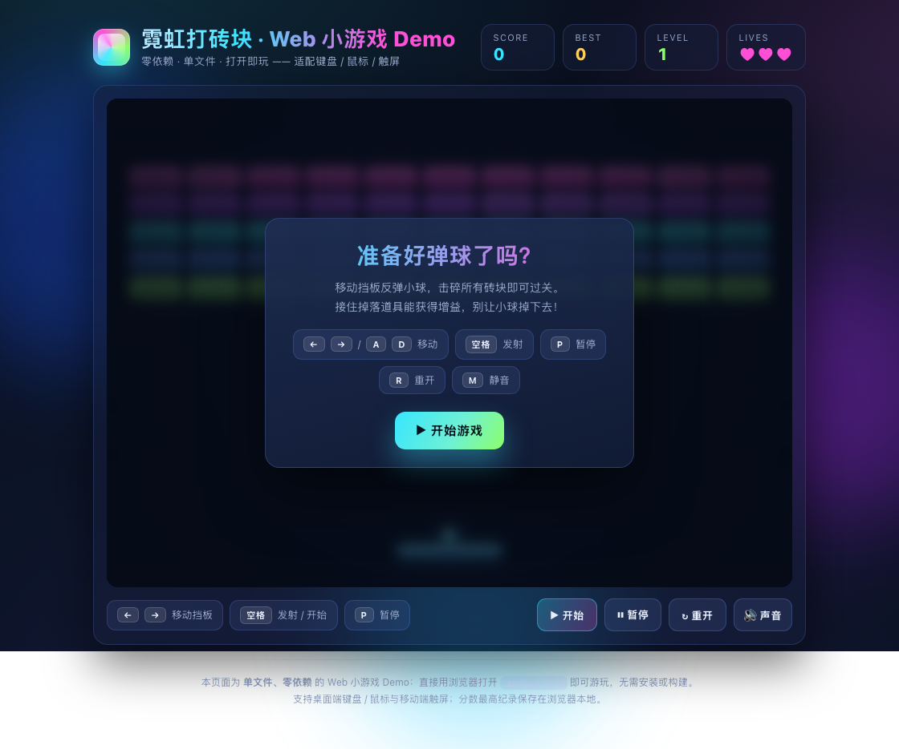
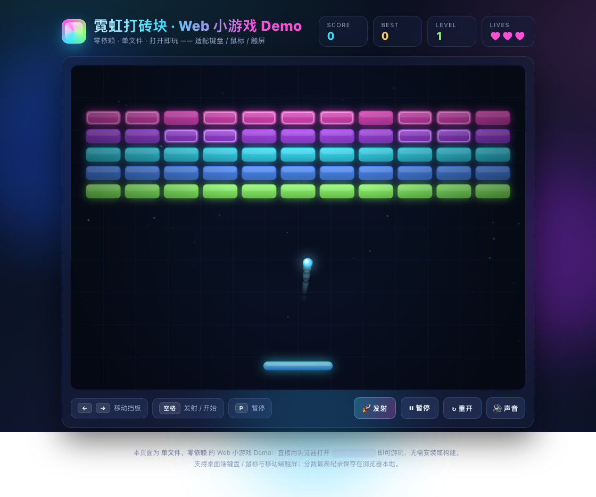

# agent-core

## Web 小游戏 Demo —— 霓虹打砖块

一个**零依赖、单文件**的 Web 小游戏 demo 页面：霓虹风格的打砖块（Breakout）。
直接用浏览器打开 [`index.html`](./index.html) 即可游玩，无需安装、无需构建。

| 预览 | |
| --- | --- |
| 开始界面 |  |
| 游戏进行 |  |

### 特性

- **单文件 / 零依赖**：所有渲染、物理、音效、UI 都在 `index.html` 内，离线可用。
- **多端操作**：键盘（`←` `→` / `A` `D` 移动，`空格` 发射）、鼠标移动挡板、移动端触屏拖动。
- **完整玩法**：反弹小球击碎砖块、双血砖块、连击加分、5 个关卡递进加速、3 条生命。
- **道具系统**：加宽挡板、子弹时间、额外生命、双倍得分。
- **表现力**：霓虹辉光、粒子特效、小球拖尾、屏幕震动、WebAudio 音效（可静音）。
- **本地记录**：最高分保存在浏览器 `localStorage`。

### 操作说明

| 按键 | 作用 |
| --- | --- |
| `←` `→` / `A` `D` | 左右移动挡板 |
| `空格` / 点击 | 发射小球 / 开始 / 继续 |
| `P` / `Esc` | 暂停 / 继续 |
| `R` | 重新开始 |
| `M` | 静音 / 开启声音 |

### 运行方式

1. 用浏览器直接打开 `index.html`；或
2. 起一个静态服务器后访问，例如：

   ```bash
   python3 -m http.server 8000
   # 打开 http://127.0.0.1:8000/index.html
   ```

> 提示：`index.html?autostart=1` 会自动开始一局，便于截图 / 冒烟测试。
